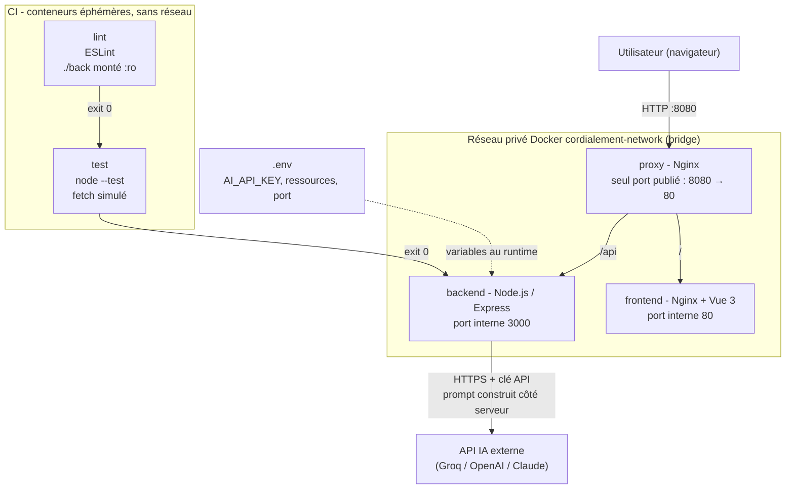

# Cordialement - Traducteur Corporate par IA

Outil parodique qui traduit une pensée brute (« Ludovic tu me fais chier avec tes questions ») en message corporate, politiquement correct et subtilement passif-agressif (« Merci Ludovic pour ton intérêt, je reviens vers toi dès que mon emploi du temps le permettra »).

L'application est découpée en micro-services Docker orchestrés par Docker Compose : un front, une API, un reverse proxy, et deux conteneurs de CI (lint + tests) qui conditionnent le démarrage de l'API.

## Démarrage rapide

```bash
cp .env.example .env      # puis renseigner AI_API_KEY (optionnel)
docker compose up --build -d
```

Ouvrir http://localhost:8080 (ou le port choisi dans `PROXY_PORT`).

```bash
curl -X POST http://localhost:8080/api/translate \
     -H "Content-Type: application/json" \
     -d '{"text":"Ludovic tu me fais chier avec tes questions"}'
# {"original":"...","translated":"...","source":"ai"}
```

Sans clé IA, ou si l'IA est indisponible (par exemple un quota gratuit dépassé, erreur 429), l'application fonctionne quand même : le backend répond avec une phrase corporate locale (`"source":"fallback"`).

## Architecture



Ordre de démarrage imposé par `depends_on` :

1. `lint` doit se terminer avec le code 0.
2. `test` démarre, et doit aussi se terminer avec le code 0.
3. `backend` démarre, puis doit devenir `healthy` (`/api/health` répond 200). En parallèle, `frontend` démarre et doit devenir `healthy`.
4. `proxy` démarre en dernier : il ne reçoit donc jamais de trafic vers un service pas encore prêt (pas de 502).

Les healthchecks testent toutes les 5 s, avec 3 essais avant de déclarer un service `unhealthy`. Le service est donc détecté prêt (ou en panne) en quelques secondes, sans surcharger les conteneurs.

Pourquoi un backend ? Le navigateur ne doit jamais voir la clé de l'API IA. Le front envoie uniquement le texte brut ; c'est le backend qui construit le prompt et appelle l'IA. Le proxy est le seul conteneur exposé à l'hôte : le backend n'est joignable que par le réseau Docker interne, via la résolution DNS des noms de services (`http://backend:3000`).

## Les images

Toutes les images partent d'une base officielle minimale et sont personnalisées par un `Dockerfile` (code, configuration, utilisateur, signal d'arrêt). Aucune image du Docker Hub n'est utilisée telle quelle.

Le choix d'Alpine est le même partout : distribution d'environ 5 Mo, moins de paquets donc moins de failles potentielles, et des pulls plus rapides. Ses outils `busybox` (dont `wget`) sont déjà présents, ce qui permet les healthchecks sans rien installer.

Deux choix communs à toutes les images :

- **Aucun `ARG` de build** : tout ce qui varie (clé IA, modèle, port, ressources) est une variable d'environnement lue au run. On change la configuration sans reconstruire l'image.
- **Un `.dockerignore` pour chaque image qui copie du code** (back, front, proxy) : `node_modules`, `.git` et les logs ne sont pas envoyés au build. Le contexte est plus léger, le build plus rapide, et les `node_modules` de la machine hôte ne viennent pas écraser ceux installés par `npm ci` dans l'image.

### 1. Backend - `back/Dockerfile` (`node:24-alpine`, 3 étapes)

| Étape | Rôle |
|---|---|
| `base` | `npm ci --omit=dev` : installe uniquement `express`, à la version exacte du `package-lock.json`. Ensuite `npm cache clean --force` vide le cache npm, inutile à l'exécution. |
| `test` | Ajoute `src/` et `test/` à `base`. Utilisée par le conteneur CI `test` : on teste avec exactement les dépendances livrées en production. |
| `production` | Ajoute seulement `src/` à `base`. Les tests ne sont donc pas dans l'image livrée. |

- **Pourquoi Node 24** : c'est la version LTS active. Node 20 ne reçoit plus de correctifs de sécurité depuis avril 2026.
- **Dépendances** : `express` est le serveur HTTP. L'appel à l'IA utilise le `fetch` natif de Node : aucune bibliothèque supplémentaire.
- **Opérations sur l'OS** :
  - `addgroup -S appgroup && adduser -S appuser -G appgroup` crée un utilisateur système sans mot de passe ni shell de connexion. Le processus ne tourne donc pas en `root` : en cas de faille dans l'API, l'attaquant n'a aucun droit d'administration dans le conteneur.
  - `COPY --chown=appuser:appgroup` donne les fichiers à cet utilisateur dès la copie. On évite ainsi un `chown -R` après coup, qui dupliquerait tous les fichiers dans une couche supplémentaire.
- **Port** : `EXPOSE 3000`. Ce n'est qu'une documentation : le port n'est pas publié sur l'hôte.
- **Entrypoint** : `ENTRYPOINT ["node"]` + `CMD ["src/server.js"]`.
  - La forme exec (tableau JSON) lance `node` directement, sans shell intermédiaire, pour que le processus reçoive le `SIGTERM`.
  - On n'utilise pas `npm start`, car npm ne transmet pas correctement les signaux à node.
  - `ENTRYPOINT` fixe l'exécutable et `CMD` le script, qui peut être remplacé au run sans rebuild.

### 2. Frontend - `front/Dockerfile` (multi-stage `node:24-alpine` → `nginx:alpine`)

- **Étape de build** : `npm ci` installe, aux versions exactes du lockfile, Vue 3 (framework), Vite (bundler), TypeScript et `vue-tsc` (typage), Tailwind avec PostCSS et Autoprefixer (CSS). Ces outils ne servent qu'à compiler, aucun n'arrive dans l'image finale. `npm run build` lance `vue-tsc` (vérification des types) puis `vite build`.
- **Étape finale** : seul le dossier `dist/` (fichiers statiques compilés) est copié dans Nginx. Le code source, `node_modules` et les outils de build restent dans l'étape intermédiaire : l'image finale pèse environ 93 Mo au lieu de plusieurs centaines.
- **Opérations sur l'OS** : `rm -rf /usr/share/nginx/html/*` supprime les pages par défaut de Nginx (page d'accueil, page d'erreur) : seule notre application est servie. Notre `nginx.conf` remplace la configuration par défaut (routage SPA `try_files` et cache long des assets).
- **Utilisateur** : pas d'utilisateur ajouté. Le processus maître de Nginx démarre en root uniquement pour ouvrir le port 80, puis les processus qui traitent les requêtes tournent sous l'utilisateur `nginx` déjà prévu par l'image.
- **Port** : `EXPOSE 80`.
- **`STOPSIGNAL SIGQUIT`** : pour Nginx, `SIGTERM` déclenche un arrêt immédiat, alors que `SIGQUIT` déclenche un arrêt gracieux qui termine les requêtes en cours.
- **Entrypoint** : `ENTRYPOINT ["nginx"]` + `CMD ["-g", "daemon off;"]`. Par défaut Nginx passe en arrière-plan ; le PID 1 se terminerait alors et Docker arrêterait le conteneur. `daemon off;` le garde au premier plan.

### 3. Reverse proxy - `proxy/Dockerfile` (`nginx:alpine`)

- **Personnalisation** : notre `default.conf` remplace la configuration par défaut de Nginx. `/api` est envoyé vers `backend:3000`, tout le reste vers `frontend:80`. Aucun paquet n'est installé : Nginx suffit à faire du reverse proxy.
- **Utilisateur** : même fonctionnement que le frontend (maître en root pour le port 80, requêtes traitées par l'utilisateur `nginx`).
- **Port** : `EXPOSE 80`, publié sur l'hôte par le compose (`PROXY_PORT`, 8080 par défaut).
- **`STOPSIGNAL SIGQUIT`** et **entrypoint** : identiques au frontend, pour les mêmes raisons.

### 4. Lint - `ci/Dockerfile.lint` (`node:24-alpine`)

- **Dépendance** : `npm install -g eslint@10.13.0` est le seul outil de l'image (une image = un outil). La version est figée pour obtenir le même résultat sur toutes les machines. `npm cache clean --force` supprime ensuite le cache de téléchargement, inutile dans l'image.
- **Pas de copie du code** : `./back` est monté en lecture seule (`:ro`) au run, donc le job de CI ne peut pas modifier le code qu'il vérifie.
- **Règles** : `back/eslint.config.js` liste les règles explicitement (variables non déclarées ou inutilisées, code inatteignable, `===` obligatoire…), sans `import`. Le volume monté ne contient pas de `node_modules`, et ESLint n'en a pas besoin.
- **Utilisateur** : `USER node` (utilisateur non-root déjà fourni par l'image Node).
- **Entrypoint** : `ENTRYPOINT ["eslint"]` + `CMD ["."]`. Le conteneur se comporte comme une commande, et son code de sortie (0 = propre, 1 = erreur) est le verdict.

### 5. Tests - étape `test` de `back/Dockerfile`

- **Entrypoint** : `ENTRYPOINT ["node"]` + `CMD ["--test", "test/index.test.js"]`. On utilise le test runner intégré à Node : aucune dépendance de test à installer.
- **Pas d'appel réel à l'IA** : les tests remplacent `fetch` par une fausse réponse (`t.mock.method`). Ils sont donc gratuits, déterministes et ne demandent pas de clé. Le compose coupe en plus le réseau du conteneur (`network_mode: none`).
- **Ce qui est couvert** : healthcheck, mode fallback sans clé, réponse IA, bascule en fallback si l'IA est en erreur, texte manquant, texte trop long.

## Arguments au run (docker compose)

Toutes les valeurs viennent du fichier `.env` (modèle : `.env.example`). Le compose les injecte avec `${VARIABLE:-valeur par défaut}`, il fonctionne donc même sans `.env`.

| Variable | Conteneur | Rôle | Défaut |
|---|---|---|---|
| `AI_API_KEY` | backend | Clé de l'API IA. Fournie au runtime uniquement, jamais inscrite dans une image ni commitée. Vide = mode fallback. | vide |
| `AI_API_URL` | backend | Endpoint au format OpenAI « chat completions ». On change de fournisseur sans rebuild. | Groq |
| `AI_MODEL` | backend | Modèle utilisé. | `qwen/qwen3.8-27b` |
| `AI_TIMEOUT_MS` | backend | Délai max de l'appel IA. Il est inférieur aux 10 s du `docker stop`, pour qu'une requête bloquée ne provoque jamais de SIGKILL. | `8000` |
| `PORT`, `NODE_ENV` | backend | Port d'écoute interne. `production` active les optimisations d'Express et masque les détails d'erreur. | `3000`, `production` |
| `PROXY_PORT` | proxy | Port publié sur l'hôte (utile si 8080 est déjà pris). | `8080` |
| `*_CPUS`, `*_MEMORY` | tous | Ressources allouées à chaque conteneur (voir ci-dessous). | voir tableau |

Équivalent sans compose, par exemple pour le backend :

```bash
docker run -d --init --cpus 0.5 --memory 128m \
  -e AI_API_KEY=... -e AI_API_URL=... -e AI_MODEL=... \
  --network cordialement_cordialement-network --name backend cordialement-backend
```

## Limitation des ressources

Les conteneurs partagent le CPU et la RAM de l'hôte. Sans limite, un seul conteneur qui s'emballe peut saturer la machine. Avec une limite, le dépassement de mémoire tue uniquement ce conteneur (code 137, OOM) et `restart: unless-stopped` le relance.

| Conteneur | CPU | RAM | Justification |
|---|---|---|---|
| backend | 0.50 | 128M | Environ 21 Mo mesurés au repos (`docker stats`). La marge sert à absorber les requêtes simultanées en attente de l'IA. C'est le service le plus sollicité. |
| frontend | 0.20 | 64M | Environ 9 Mo mesurés : Nginx ne fait que servir des fichiers statiques. |
| proxy | 0.20 | 64M | Environ 9 Mo mesurés : Nginx ne fait que relayer des requêtes. |
| lint | 0.50 | 256M | Pic court pendant l'analyse de tout le code, puis le conteneur s'arrête. |
| test | 0.50 | 256M | Pic court (serveur Express + test runner), puis le conteneur s'arrête. |

Vérification : `docker stats`.

## Gestion du SIGTERM

À l'arrêt (`docker compose stop`), Docker envoie le `STOPSIGNAL` au PID 1, attend 10 s, puis envoie `SIGKILL`.

- **Backend** :
  - `init: true` place `tini` en PID 1 ; il transmet les signaux à node et récupère les processus zombies.
  - `server.js` intercepte `SIGTERM` et `SIGINT`, appelle `server.close()` (plus de nouvelles connexions, fin des requêtes en cours), puis `process.exit(0)`.
  - Le timeout de l'appel IA (`AI_TIMEOUT_MS`) garantit que cette fermeture se fait avant les 10 s.
- **Frontend et proxy** : `STOPSIGNAL SIGQUIT` pour l'arrêt gracieux de Nginx, plus `init: true`.

Preuve par les codes de sortie (référence : [codes de sortie des conteneurs](https://komodor.com/learn/exit-codes-in-containers-and-kubernetes-the-complete-guide/)) :

```bash
docker compose stop
docker inspect -f '{{.Name}} {{.State.ExitCode}}' cordialement-backend cordialement-frontend cordialement-proxy
# exit 0 partout : arrêt propre en quelques secondes
# 137 = tué par SIGKILL (timeout dépassé ou OOM), 143 = SIGTERM reçu mais non géré
```

## CI : lint et tests dans des conteneurs

Chaque étape est un conteneur qui s'exécute une fois puis s'arrête (`restart: "no"`). Le contrat est le code de sortie : `depends_on: condition: service_completed_successfully` ne démarre l'étape suivante que si la précédente a terminé avec `0`. Un code qui ne passe pas le lint ou les tests n'est donc jamais démarré.

```bash
docker compose run --rm lint      # relancer seulement le lint
docker compose run --rm test      # relancer seulement les tests
docker compose logs lint test     # lire le résultat du dernier pipeline
```

Démonstration : ajouter `const unused = 1;` dans `back/src/app.js`, puis lancer `docker compose up -d`. Le lint sort en `exit 1`, et `test`, `backend` et `proxy` restent à l'état `Created`.

## Pourquoi Docker Compose et pas Docker Swarm

La consigne demande 2 conteneurs parmi : scaling, lint, test. Nous avons choisi lint et test, et donc Compose plutôt que Swarm :

- **Un seul hôte.** Swarm sert à répartir des conteneurs sur un cluster de plusieurs machines. Notre projet tourne sur une seule machine, ce qui correspond au rôle de Compose.
- **Pas de besoin de scaling.** Le trafic d'un outil parodique ne justifie pas plusieurs répliques. Et le vrai goulot est l'API IA externe : ajouter des répliques du backend n'accélère pas Groq, et consommerait plus vite le quota gratuit.
- **Swarm ne sait pas exécuter une CI.** Il redémarre les conteneurs qui s'arrêtent, pour maintenir N répliques en vie, et il ignore `depends_on`. Nos jobs de lint et de test doivent au contraire s'exécuter une fois, dans l'ordre, et s'arrêter : c'est le modèle de Compose (`service_completed_successfully`).
- **Swarm ignore `build`.** Il faudrait construire chaque image à l'avance et la pousser dans un registry. C'est une étape et un service de plus, sans bénéfice pour ce projet.
- **Swarm n'a pas d'autoscaling.** Il faudrait un conteneur supplémentaire qui surveille le CPU et lance `docker service scale`, comme dans l'exemple du cours.

Si le projet devait un jour servir beaucoup d'utilisateurs sur plusieurs serveurs, on garderait la CI dans Compose et on déploierait les services applicatifs (`frontend`, `backend`, `proxy`) avec `docker stack deploy`.

## Docker vs virtualisation classique

Une machine virtuelle émule un matériel complet et démarre un système d'exploitation entier avec son propre noyau. Elle demande des minutes de démarrage et des Go de disque et de RAM. Un conteneur partage le noyau de l'hôte et n'isole que des processus, ce qui le rend bien plus léger :

- les 3 services applicatifs démarrent en quelques secondes ;
- au repos, ils consomment ensemble moins de 40 Mo de RAM ;
- chaque image se reconstruit à l'identique sur n'importe quelle machine à partir de son `Dockerfile`.

La contrepartie est une isolation plus faible qu'une VM. D'où les utilisateurs non-root, le réseau privé et l'exposition d'un seul port.

## Arborescence

```
.
├── back/                 API Node.js (Express) + tests + règles ESLint
│   ├── src/services/     appel à l'API IA (prompt, timeout)
│   └── src/data/         phrases du mode fallback
├── front/                Vue 3 + TypeScript + Tailwind, servi par Nginx
├── proxy/                Nginx reverse proxy (seul point d'entrée)
├── ci/                   image de lint
├── docker-compose.yml    orchestration + pipeline CI
└── .env.example          arguments du run (copier en .env)
```
